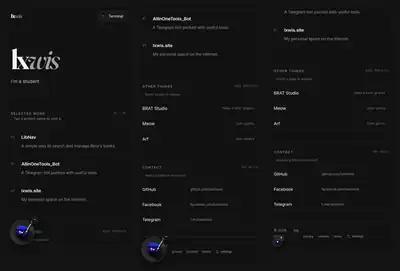
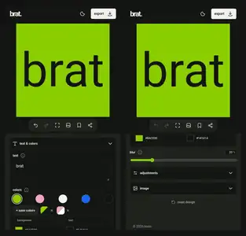
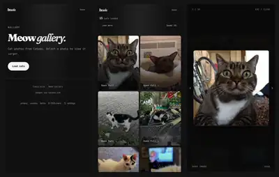
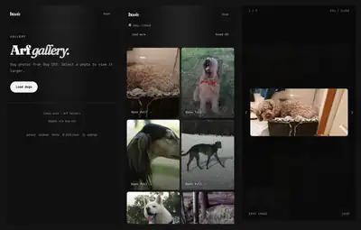

# lxwis.site

My personal space on the internet — [**visit lxwis.site**](https://lxwis.site).

## Website preview

<table>
  <tr>
    <td align="center" width="50%">
      <a href="https://lxwis.site"></a>
      <br><strong><a href="https://lxwis.site">Homepage</a></strong>
    </td>
    <td align="center" width="50%">
      <a href="https://lxwis.site/brat"></a>
      <br><strong><a href="https://lxwis.site/brat">BRAT Studio</a></strong>
    </td>
  </tr>
  <tr>
    <td align="center">
      <a href="https://lxwis.site/meow"></a>
      <br><strong><a href="https://lxwis.site/meow">Meow Gallery</a></strong>
    </td>
    <td align="center">
      <a href="https://lxwis.site/arf"></a>
      <br><strong><a href="https://lxwis.site/arf">Arf Gallery</a></strong>
    </td>
  </tr>
</table>

*Mobile screenshots from the website. Click any preview to open that page.*

## Projects

- [**BRAT Studio**](https://lxwis.site/brat) — create and export BRAT-style graphics, with an [Android APK](https://github.com/iamlxwis/portfolio/releases).
- [**Meow**](https://lxwis.site/meow) — browse and save cat photos.
- [**Arf**](https://lxwis.site/arf) — browse and save dog photos.
- [**LibNav**](https://libnav.lxwis.site) — search and manage library books.
- [**AllinOneTools_Bot**](https://t.me/AllinOneTools_Bot) — Telegram utilities.

## Repository structure

```text
.github/workflows/    CI & Android builds
android/brat/         Capacitor Android app
docs/                 Documentation and screenshots
main/                 Website (Vercel root)
  assets/             Homepage and shared styles/scripts
  brat/               BRAT editor
  meow/               Cat gallery
  arf/                Dog gallery
  legal/              Privacy, cookies and terms
  pages/              Changelog
  api/                Backend functions
  index.html          Homepage entry
  404.html            Not-found page
  vercel.json         Routes and cache rules
```

## Development & deployment

The Vercel **Root Directory** is `main/`. Keep it unchanged unless Vercel settings and routing are updated too.

- [Website source guide](docs/website.md)
- [Build the BRAT Android APK](android/brat/README.md)

[Privacy](https://lxwis.site/privacy) · [Cookies](https://lxwis.site/cookies) · [Terms](https://lxwis.site/terms)

<sub>© 2026 lxwis</sub>
